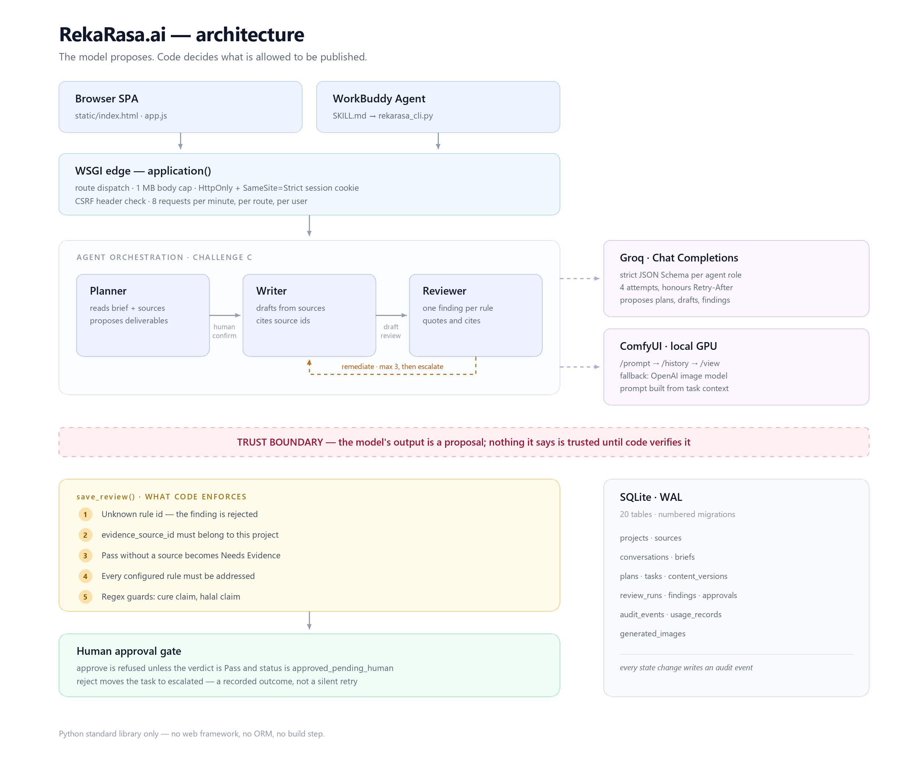

# RekaRasa.ai — the creator agent that refuses unsourced claims

RekaRasa is a creator workspace that turns a product brief into marketing copy, and then **will not let that copy through until its claims are backed by a source attached to the project**. Three agents propose. Server-side code decides. A human approves. The model never has the last word.

Built for **AI CAN DO IT — Tencent Cloud Hackathon Indonesia 2026**, Challenge C (The Creator Agent).



## Why this is not a text generator with a review button

Most "agent" demos ask a model to grade its own homework. That is not accountability — it is a second opinion from the same source of error. RekaRasa splits the work so that no single component can wave content through:

| Layer | Job | Can it be talked out of it? |
|---|---|---|
| **Model** (Groq `openai/gpt-oss-20b`) | Proposes findings | Yes — this is the component we assume can be wrong |
| **Code** (`save_review()`) | Decides whether a finding is valid | No — not from any client |
| **WorkBuddy** | Runs the loop, picks the next step | No — it reads the verdict, it cannot change it |
| **Human** | Approves | That is the point |

Seven checks run in `save_review()`, all of them in code, none of them in the prompt:

1. A `rule_id` that is not in the project's rule registry cannot support a pass.
2. A `source_id` that is not attached to this project cannot support a pass.
3. A pass on a factual rule must cite the source that states the fact.
4. Any configured rule the Reviewer did not address is recorded as `Needs Evidence`, never as a silent pass.
5. A disease-cure claim or an undocumented halal claim is caught by regex even when the Reviewer says `Pass`.
6. A draft below the character floor for its format is not a deliverable, and a revision that keeps less than half of the previous draft is flagged.
7. A poster must label HEADLINE, BODY and CTA; a marketplace listing must label a title and a description. Copy nobody can separate is copy a designer cannot use.

Check 5 exists because checks 1–4 all rest on the Reviewer producing an honest finding. A rule whose pass no longer needs a citation would otherwise be enforced by trust alone, so code enforces it directly.

## The workflow

One screen, one button. The plan is still produced, but it no longer needs a
confirmation page before you see a draft:

```
brief → Planner proposes (and becomes tasks in the same request)
      → Writer drafts → Reviewer judges → save_review() decides
      → Pass            → human approval gate → approved
      → Fail / Needs Evidence → Writer remediation (max 3) → escalate
      → Reviewer crashed      → draft preserved, review retried, never a dead end
```

`POST /api/plan` takes `auto_confirm`, so a caller that does not want a separate
review screen gets its tasks back in the same response. The tasks start
`planned` — that call drafts nothing and approves nothing. The separate
`/api/confirm-plan` route still exists for a caller that does want to edit the
proposal first, and both paths create tasks through the same function.

Each state has exactly one meaning, and each action is legal in exactly one state. A human edit produces a `pending` version that needs a *review*, not a rewrite — so a Writer retry can never silently overwrite work a person typed.

## Verified, not asserted

Last run against the live provider (`openai/gpt-oss-20b`, 29 October 2026), on a throwaway database:

```
register           200
planner            201   proposed "Afternoon Calm Social Media Copy"
confirm-plan       200
writer + reviewer  201   verdict=Pass
approve            200   task → human_approved
```

Four findings, one per configured rule, all `Pass`, with the factual rule citing the attached source. Three model calls, no retries.

`46 tests pass` (`pytest test_app.py`). They cover account isolation, CSRF, source and rule reference validation, the cure-claim and halal guards, evidence requirements, bounded remediation, the approval gate, edit-after-approval, provider failure mapping, and migration idempotency.

## How WorkBuddy participates

`integrations/workbuddy/` holds the `rekarasa-creator` skill: a `SKILL.md` plus a stdlib-only CLI bridge over 17 API commands. WorkBuddy is the runtime that drives the loop — it calls the Planner, reads the verdict, chooses between remediation and escalation, and stops at the human gate.

It is an adapter, not an authority. The CLI is a thin HTTP client with no rules inside it: if the skill were deleted, every guard would still hold, because they live in `save_review()` and are enforced server-side.

## What works

- Account registration and sign-in, salted PBKDF2 password hashes, expiring HTTP-only sessions, SameSite cookies, CSRF checks on mutations, per-account sign-in throttling, and a single-use password reset token delivered through the server console.
- Per-account projects, Markdown/plain-text source material, Planner conversations, tasks, versions, reviews, findings, approvals, token usage, and audit events stored in SQLite.
- Server-side Groq Chat Completions calls with strict JSON Schema contracts for all three roles. The server validates every response against the local contract before use.
- A plan must be confirmed before tasks can generate drafts. Each revision creates a new immutable version; history is never overwritten.
- A maximum of three remediation attempts per task, then human escalation. Human approval requires a passing review of the latest version.
- Content Studio can generate and persist a PNG per task through OpenAI Images or a local ComfyUI server.
- Planner list and calendar views; production deadlines and planned publication times are separate fields. No publishing integration is configured and the app never reports a publication.
- Plain text and Markdown upload, capped at 250 KB. PDF extraction is not implemented.

## Local development

Requirements: Python 3.10+ (developed and tested on 3.12). The application uses a small standard-library `.env` loader, so no dotenv package is required. `waitress` is used by the production Docker image.

1. Copy `.env.example` to `.env` if you do not already have one; the app reads it at startup and never replaces variables already set in the process environment.
2. Set `GROQ_API_KEY` for live text generation. For OpenAI image generation, set `OPENAI_API_KEY`. For local ComfyUI, set `IMAGE_PROVIDER=comfyui`, `COMFYUI_URL` (default `http://127.0.0.1:8188`), and `COMFYUI_CHECKPOINT` to the exact installed checkpoint filename.
3. Start with `python app.py` from this directory.
4. Open `http://127.0.0.1:8000`, create an account, and start in the seeded **Demo · Jahe Rasa** project.

The app creates `data/rekarasa.sqlite3`, stores image files in `data/generated-images`, and applies numbered SQL migrations from `migrations/` plus the versioned demo rule registry at startup. Migration versions are recorded in `schema_migrations`. To reset a local demo, stop the server and remove that local `data` directory. Do not do that on a deployment without exporting the database first.

## Tests and checks

```
python -m pytest test_app.py -q     # 63 passed
python -m py_compile app.py test_app.py
node --check static/app.js
node probe_frontend.js              # calendar and diff behaviour
```

Tests use fake model and image services and make no paid API calls. The live provider path was verified separately against Groq, as recorded above.

`probe_frontend.js` is the only frontend check that executes code. `node --check`
proves the file parses; it does not prove `calendarView()` runs. The probe loads
the real functions against a stub DOM and asserts on the markup they produce,
which is how two calendar bugs were caught: a task due and published on the same
date counted twice in the open-count badge, and the item needing attention was
pushed behind the "+1 more" marker. It is not a browser and makes no claim about
layout.

**Not verified:** the ComfyUI image path has only fake-service coverage — no local ComfyUI server was reachable, so `IMAGE_PROVIDER=comfyui` is exercised by tests but has not produced a real image here. There is also no public deployment URL; everything above was run locally.


## Environment variables

| Name | Purpose | Default |
|---|---|---|
| `APP_ENV` | Set to `production` to add the Secure cookie attribute | `development` |
| `HOST` | Bind address | `127.0.0.1` |
| `PORT` | HTTP port | `8000` |
| `DATABASE_PATH` | SQLite path; use persistent mounted storage when hosted | `./data/rekarasa.sqlite3` |
| `LLM_PROVIDER` | Provider selector (currently Groq) | `groq` |
| `GROQ_API_KEY` | Server-only Groq API credential | unset; agent calls fail clearly |
| `MODEL` | Groq text model ID | `openai/gpt-oss-20b` |
| `IMAGE_PROVIDER` | Image provider (`openai` or `comfyui`) | `openai` |
| `OPENAI_API_KEY` | Server-only OpenAI Images credential | unset; image action reports setup instructions |
| `IMAGE_MODEL` | OpenAI image generation model | `gpt-image-2.5-sunburst` |
| `COMFYUI_URL` | Local ComfyUI server base URL | `http://127.0.0.1:8188` |
| `COMFYUI_CHECKPOINT` | Installed SD 1.5 checkpoint filename used by ComfyUI | unset; required when provider is `comfyui` |
| `COMFYUI_TIMEOUT` | Maximum time to wait for ComfyUI generation (seconds, capped at 900) | `300` |
| `IMAGE_STORAGE_PATH` | Generated PNG storage folder; use durable storage when hosted | `./data/generated-images` beside SQLite database |
| Groq API base URL | OpenAI-compatible Chat Completions endpoint | `https://api.groq.com/openai/v1` |

Groq documents `openai/gpt-oss-20b` as supporting strict JSON Schema outputs. All fields in the strict schemas are required and nested objects disallow extra fields. Local-only array bounds are removed from the outbound provider schema and still checked by application validation. Provider errors, invalid JSON, and schema-invalid responses fail the agent run rather than being accepted as successful output. See [Groq Structured Outputs](https://console.groq.com/docs/structured-outputs) and [OpenAI compatibility](https://console.groq.com/docs/openai).

Each account is private within the database. The seeded demo project is created on registration for each account; no shared privileged login is embedded in the app.

## Deployment preparation

`Dockerfile` and `render.yaml` describe a Render web service in Singapore with a persistent 1 GB disk mounted at `/var/data`. SQLite is appropriate here only for this single-service demo deployment; do not scale the service to multiple instances. The blueprint expects a Render account, a valid Groq key, and a paid persistent disk.

1. Push this new directory as its own repository; it has no dependency on the old project.
2. In Render, create a Blueprint from that repository and inspect the proposed service and disk before applying it.
3. Add a valid `GROQ_API_KEY` as a secret in the Render dashboard. Keep it out of Git and client assets.
4. Deploy, then verify `/api/health`, sign-in, source persistence after restart, and one full plan → confirm → generate → review workflow.
5. Back up `/var/data/rekarasa.sqlite3` before destructive maintenance. To recover, restore the database to the persistent disk and redeploy the same image.

No hosting account is bundled with this project. Live inference should be verified using the server-side Groq key before demo day. A deploy is not complete until Render returns a public URL and the deployed workflow has been verified.

## Review boundaries

The `DEMO-*` rules are sample product policies, not legal requirements, legal advice, a halal certification assessment, or a complete advertising-compliance engine. A Reviewer model result is only one part of the process: code validates schema, ownership, rule IDs and source IDs, evidence requirements, approval transitions, and attempt limits. Uncertain findings should remain `Needs Evidence` or go to a human.

## Known limits

- PDF text extraction, email verification, external identity providers, multi-seat collaboration, background queues, scheduled publishing, and platform publishing are not implemented.
- Password reset works without a mail server: the server prints a single-use token to its own console and the person pastes it back. Nothing is emailed.
- SQLite and the embedded server target one low-volume demo instance. Use managed Postgres and a production-grade job/server architecture before multi-instance or high-traffic use.
- Model calls can fail from invalid credentials, provider limits, timeouts, malformed data, or unavailable network; the UI reports the failure and preserves a retry path where possible.
- Estimated cost is not shown because no model pricing table is bundled. Input and output token totals are recorded when returned by Groq.
