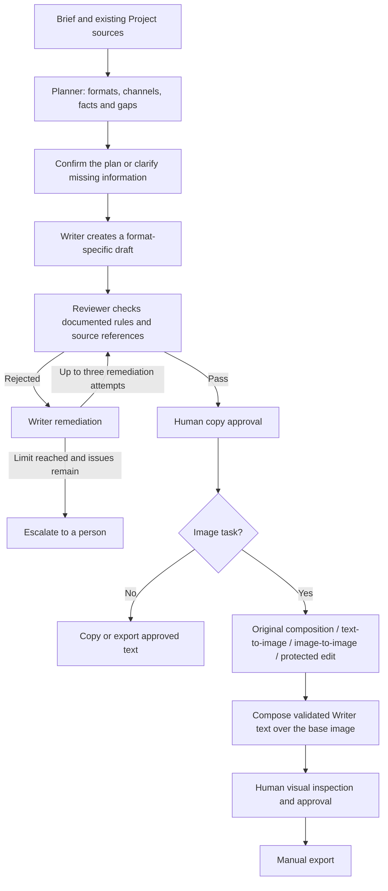

# Challenge C: agent workflow and image modes

## Scope and evidence

This pass uses the two handbook pages supplied in the conversation. It does not certify compliance with the complete hackathon handbook or Indonesian law. The existing Planner, Writer and Reviewer share the configured text model through separate prompts, contracts and recorded runs; three agent roles do not require three different model vendors.

## User journey



Base images can be prepared before copy approval, but approval/export of the final composition remains gated. Publication is not connected. The existing iteration convention is an initial draft followed by at most three remediation attempts; this is stated explicitly rather than describing it as three total drafts.

## Handbook mapping

| Requirement | Implementation and evidence | Limit |
|---|---|---|
| Planner, Writer, Reviewer | Separate role instructions and recorded agent runs in `app.py` | Shared text model, not independently trained models |
| At least two formats/platforms | Existing multi-deliverable planner; two-format orchestration test passes | A user asking for one caption is not forced into a campaign |
| Source-grounded drafts | Source IDs, task context, claim spans and deterministic checks | A valid source ID alone does not establish every semantic claim |
| Rule-based rejection | Findings retain rule IDs, versions, claim spans and explanations | Project-policy decisions are not legal certification |
| Reject → remediate → approve | Existing FreshGlow cycle passes its integration test | Test text-provider responses are controlled fixtures |
| Bounded remediation | Three-attempt server limit and escalation state | Durable recovery after a server crash is not implemented |
| Human approval | Copy and visual approvals are separate; changed versions invalidate export | No automatic publishing |
| Audit and revision history | Versions, reviews, agent runs, approvals and image generation metadata | Audit is local SQLite, not an externally notarized log |
| Image bonus | Actual local text-to-image and image-to-image calls completed | Visual identity is not automatically verified |
| Validate text on images | Structured Writer blocks, layout limits, escaped SVG and version-bound composition | No OCR proof that a diffusion background contains no incidental lettering |

Brand-tone learning from approved examples, cross-language factual equivalence, and approved conversion of human edits into new rules remain separate bonus work. They are not claimed complete here.

## Image modes

| UI mode | Input | Engine | What stays fixed |
|---|---|---|---|
| Compose selected photo + Writer copy | Existing Project photo and validated copy | Local composition | Photo pixels, subject and lettering |
| Text to image - new concept | Visual prompt and brief context | ComfyUI by default; optional configured Cloudflare | No product-identity guarantee |
| Image to image - restyle a photo | Actual bytes of the selected Project photo and prompt | ComfyUI | Original canvas size; subject details can change |
| Edit background - protect the product | Original photo, prompt and protection mask | ComfyUI | Protected decoded pixels composited at original resolution |

Image-to-image uses `LoadImage → ImageScale → VAEEncode → KSampler → VAEDecode`. This is reference conditioning, not training. Its strength choices are Subtle 0.2, Balanced 0.35 and Creative 0.6; the backend accepts finite numeric values from 0.1 through 0.85. Text generation uses full-noise sampling. Protected editing retains the separate mask/inpaint/composite path.

The installed model remains `v1-5-pruned-emaonly.safetensors`, on an RTX 4050 Laptop GPU with approximately 6 GB VRAM. No model download or paid provider enrollment was performed. Inference is scaled to SD 1.5 dimensions and resized to the output canvas; this is not native high-resolution synthesis. Other model families require a compatible workflow and a quality/memory evaluation before replacing this checkpoint.

The Cloudflare adapter remains text-only. Selecting a reference-photo mode with Cloudflare is rejected before external transmission. Cloudflare deployment and credentials remain a separate prerequisite described in [its setup guide](CLOUDFLARE_IMAGE_SETUP.md).

## Changes in this pass

- Added a pure [ComfyUI workflow builder](../comfy_workflows.py) for three generation modes.
- Added source-photo conditioning and bounded strength/seed inputs to the application and WorkBuddy CLI.
- Saved actual submitted image prompts and recorded mode, seed, strength, source ID/hash, mask hash and Writer version in audit events.
- Rechecked task, draft and photo state after inference. A changed/archived source or changed draft causes a conflict instead of saving a mismatched image.
- Kept previews separated by generation mode, provider and selected source. Older images without provenance remain available in history, without being labelled as newly reference-conditioned output.
- Preserved the selected Project photo when image data reloads.
- Put creator visual direction ahead of generic context in text-to-image prompts.
- Changed real certificate-number handling to `Needs Evidence` by default. `CERTIFICATE_REGISTRY_MODE=mock_demo` explicitly opts into synthetic fixture behavior; it must not be presented as official verification. Real certificate verification and a documented resolution workflow are still absent. Removing unsupported certification wording allows ordinary content remediation to continue.

## Verification

66 targeted tests passed: image-mode routing, actual reference-byte handoff, source ownership, invalid strengths/seeds, source archival during inference, provenance, visual text/layout, stale approval/export rejection, evidence binding, certificate uncertainty, handbook cure-claim examples, two-format orchestration, and the remediation limit/cycle.

Command:

```powershell
python scripts/run_tests.py test_image_modes test_visual_content test_evidence_binding test_app.WorkflowTests.test_demo_cure_rule_rejects_a_disease_cure_claim test_app.WorkflowTests.test_the_handbook_obat_maag_case_is_caught_by_code test_app.WorkflowTests.test_three_remediations_is_a_hard_server_limit test_app.WorkflowTests.test_human_cannot_approve_without_a_passing_latest_review test_app.WorkflowTests.test_freshglow_reject_revise_re_review_and_explicit_human_approval test_app.WorkflowTests.test_orchestrated_brief_to_review_to_human_approval
```

An initial 34-test run had one outdated assertion: it expected immediate task creation after unsupported planner facts were removed. The current application instead pauses that plan for confirmation. The test was corrected to assert the pause and explicitly confirm; the application gate was not bypassed. The final 66-test run passed in 38.692 seconds. This is targeted regression coverage, not a claim that the complete legacy test suite passes.

Python AST, JavaScript syntax and whitespace checks passed.

Two actual local generations were completed through the adapter, using an isolated temporary database and no real Project data:

1. Text-to-image, seed 42, 512×512: a red cup on a blue background. ComfyUI logged 28.91 seconds.
2. Image-to-image using that generated PNG as the source, strength 0.2, seed 42, 512×512. ComfyUI logged 8.98 seconds.

Both outputs were opened for visual inspection after recovering the interrupted session. The second retains the cup placement and broad shape but adds visible grain/texture. This proves reference conditioning executes; it does not prove product fidelity or an improvement in image quality. The images are disposable test outputs, not approved user assets. Protected-pixel compositing has workflow/integration coverage but was not separately generated and pixel-compared in this pass.

## Running the changes

Start ComfyUI in its own terminal and restart RekaRasa after code changes. The temporary agent-managed ComfyUI process stopped across the interrupted session, so a successful prior generation does not mean port 8188 is still online.

```powershell
cd D:\AI-Experiments\ComfyUI
.\.venv\Scripts\python.exe main.py --listen 127.0.0.1 --port 8188
```

Refresh the application, open an image task, select its Project photo and choose the desired image mode. Start with Subtle when restyling. Use original composition for packaging, labels or logos that must remain exact. Inspect the visual before approving it.

The largest remaining engineering risk is synchronous inference inside HTTP requests: a browser/server interruption can leave a GPU job running without durable recovery. No automatic retry or cloud fallback is used. A durable job queue should be the next reliability improvement before multi-user deployment.

## Reference

[Official ComfyUI image-to-image tutorial](https://docs.comfy.org/tutorials/basic/image-to-image) documents reference-image conditioning and the effect of denoise. The handbook mapping above comes from the two supplied screenshots.
