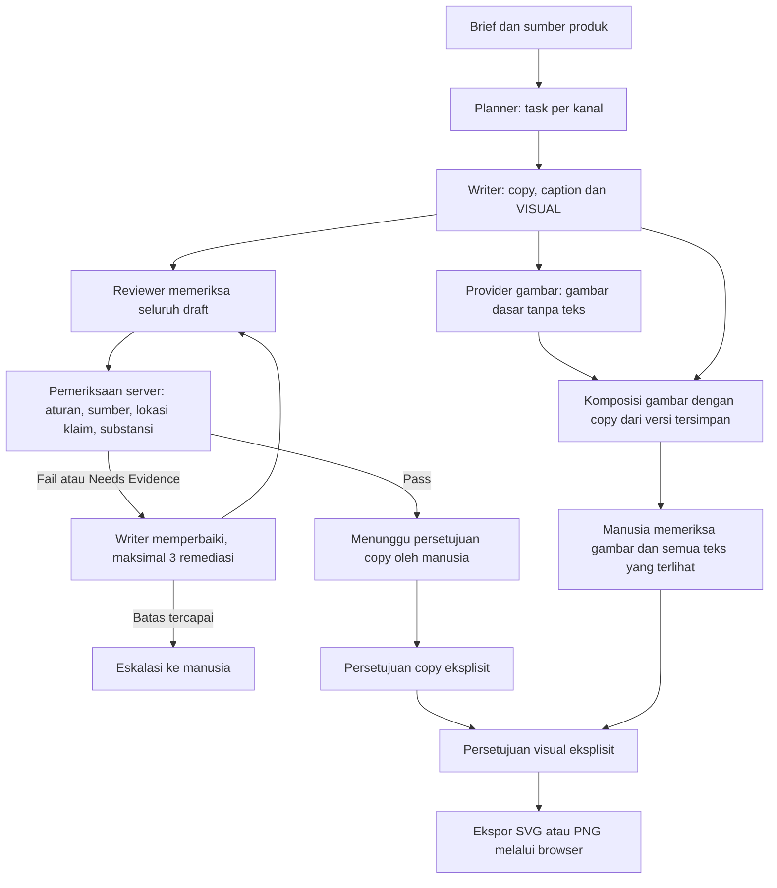

# Demo Creator Agent: copy dan gambar dari satu brief

## Yang dikerjakan

Pengguna menjelaskan produk dan kebutuhan konten dalam brief. Kanal dan output
tetap opsional. Planner membuat task terpisah; Writer menulis copy sesuai kanal;
Reviewer memeriksa draft lengkap, termasuk teks gambar dan caption, terhadap
kebijakan proyek dan sumber. Tidak ada skor kualitas buatan.

Untuk task gambar, workbench menampilkan studio visual sebelum draft/review.
`HEADLINE`, `BODY`, dan `CTA` menjadi teks pada gambar. `CAPTION` tetap menjadi
copy pendamping. `VISUAL` mengarahkan provider gambar yang sudah dikonfigurasi.
Tidak ada perubahan provider, kredensial, framework atau database reset.

## Alur yang dapat ditunjukkan



Preview boleh dibuat sebelum copy disetujui. Preview bukan hasil akhir yang
disetujui. Approval visual dan ekspor final memerlukan approval copy versi terbaru,
hasil review Pass, serta konfirmasi inspeksi visual. Mengedit copy membuat versi
baru; komposisi lama menjadi stale dan ekspornya ditolak.

Komposisi menyimpan snapshot SVG dan SHA-256 hasil render selain hash gambar dasar.
Preview dan ekspor membaca snapshot itu, sehingga perubahan layout/renderer di
masa depan tidak mengubah aset yang sudah disetujui. Hash yang berubah menolak
approval/ekspor. Snapshot ikut ekspor data akun sebagai base64.

## Arah editorial per kanal

| Kanal | Arah | Kanvas awal untuk gambar |
|---|---|---|
| Instagram | Pesan visual utama, copy gambar pendek, caption terpisah | Portrait 4:5 |
| TikTok | Photo post/cover bila meminta gambar; hook/adegan/VO bila meminta video | Vertical 9:16 |
| Facebook | Post percakapan, gambar dan satu ajakan yang jelas | Square 1:1 |
| Threads | Post/percakapan atau thread; gambar bila memang diperlukan | Portrait 4:5 |
| X | Post ringkas/thread; kartu gambar bila diminta | Wide 7:4 |
| Marketplace | Judul/deskripsi faktual; gambar produk/kartu informasi sebagai output tersendiri | Square 1:1 |

Ini pilihan editorial dan kanvas aplikasi, bukan batas ukuran wajib atau kebijakan
resmi platform. Aplikasi belum merender video atau memublikasikan konten ke platform.

## Demonstrasi FreshGlow paling kecil

1. Buat/pilih proyek FreshGlow. Tambahkan sumber teks dengan **dua fakta saja**:
   FreshGlow adalah pelembap wajah untuk penggunaan harian. Teksturnya ringan.
2. Tulis brief: "Buat konten gambar peluncuran FreshGlow untuk Instagram dan
   marketplace. Gunakan dua fakta pada sumber; jangan membuat harga, manfaat,
   sertifikasi atau diskon." Kanal/format boleh kosong atau dipilih opsional.
3. Pastikan dua task terbentuk. Periksa format, kanal, angle, goal dan alasan
   pemilihannya. Dalam demo terkendali, masukkan draft buruk lewat alur edit yang
   sudah ada, lalu Run review; jangan memaksa provider live untuk berhalusinasi.
4. Draft buruk: "FreshGlow terbukti menyembuhkan jerawat dalam 7 hari! Teruji
   klinis, bersertifikat halal, dan aman untuk semua jenis kulit. Teksturnya ringan
   dan cepat meresap." Periksa penolakan, kutipan klaim dan ID aturan.
5. Pilih Revise with Writer. Periksa isi revisi: tidak boleh mempertahankan lima
   klaim tanpa bukti. Reviewer menilai ulang. Pass masih menunggu manusia.
6. Generate image. Arah awal memakai blok VISUAL dari draft. Provider hanya
   membuat gambar dasar; server memasang teks dari versi draft, bukan meminta
   model gambar mengejanya. Jika copy tidak muat, perbaiki draft dan review ulang.
7. Approve copy. Periksa preview gambar, teks, detail produk dan kemungkinan
   tulisan/badge yang tidak diminta pada gambar dasar. Centang inspeksi, lalu
   Approve this visual. PNG/SVG final baru tersedia melalui kontrol ekspor.
8. Create new version membuktikan bahwa perubahan copy menghapus kesiapan ekspor
   komposisi lama. Selesaikan review dan approval lagi untuk versi baru.

Sumber FreshGlow tidak memberi bentuk atau foto kemasan. Gambar yang dihasilkan
harus dipresentasikan sebagai konsep, bukan foto produk terverifikasi. Tidak ada
unggahan referensi foto produk atau pencocokan visual yang diklaim selesai.

## Hubungan dengan handbook

| Ketentuan | Implementasi/bukti | Batas penilaian |
|---|---|---|
| Tiga agen | Planner, Writer, Reviewer; panggilan dan hasil tersimpan | Peran terpisah dapat memakai model Groq yang sama |
| Minimal dua format/kanal | Task terpisah; preferensi tidak wajib | Kualitas setiap output live tetap perlu diperiksa |
| Fakta dari sumber | Source IDs, aturan dukungan fakta dan filtering fakta Planner | ID sumber valid belum membuktikan entailment semantik semua klaim |
| Penolakan beralasan | Finding memuat klaim, ID/versi aturan, alasan dan rekomendasi | DEMO rules adalah kebijakan proyek, bukan putusan legal |
| Reject, revise, re-review | Tes FreshGlow dan workflow revisi existing | Tes fake membuktikan alur, bukan akurasi Groq |
| Maksimal tiga remediasi | Guard server dan eskalasi existing | Agent tidak boleh membuat loop baru di luar batas |
| Approval manusia | Approval copy existing dan inspeksi/approval komposisi | Server mengautentikasi sesi; tidak membuktikan pelakunya manusia biologis |
| Audit dan revisi | Versions, agent runs/messages, findings, approvals, audit events; versi copy + gambar pada komposisi | Retensi operasional dan pengelolaan data tetap tanggung jawab operator |
| Bonus gambar dan validasi teks | Copy direview, overlay deterministik, pemeriksaan muat dan inspeksi manusia | Belum ada OCR/vision untuk seluruh gambar dasar |
| Bonus lain | Tidak ditambahkan dalam perubahan ini | Belum ada pembelajaran brand otomatis, tiga bahasa, atau usulan aturan dari edit manusia |

## Tata kelola Indonesia dan dataset

[Peta referensi resmi](../governance/references.json) menghubungkan konteks demo
dengan PerBPOM 3/2022, PerBPOM 18/2024, SE Menkominfo 9/2023, UU PDP 27/2022,
dan verifikasi informasi halal melalui BPJPH. Regulasi, pedoman etika dan kebijakan
produk dibedakan. Tidak ada aturan yang secara otomatis diberi status "disahkan
BPOM/BPJPH", dan tidak ada nomor pasal rekaan pada finding.

Referensi hukum harus diperiksa kategori, keberlakuan, bunyi ketentuan dan dokumen
buktinya sebelum menjadi aturan legal yang diaktifkan. Tenggat wajib halal tidak
ditanam ke aplikasi karena ada perubahan regulasi yang perlu verifikasi tersendiri.
Upload sumber tidak menggantikan pemeriksaan keaslian sertifikat.

[240 kasus sintetis](../evaluation/claims-v1.jsonl) dan
[datacard/metode evaluasi](../evaluation/DATACARD.md) membantu menguji lokasi klaim,
pasangan berbukti/tanpa bukti, dan kebijakan penolakan. Seluruh variasi satu keluarga
tetap pada split yang sama. Label masih author-proposed, belum adjudikasi independen.
Korpus ini tidak dilatih ke Groq, tidak menjadi fakta produk, dan belum membuktikan
akurasi Reviewer. Evaluator menerima hasil aktual, menghitung coverage, confusion
matrix, precision/recall, unsafe-pass rate, serta ketepatan claim/rule/source.

## Komponen yang berubah

- [Backend](../app.py): channel preferences, instruksi agen, komposisi, approval,
  ekspor, audit, disclosure, dan peta referensi.
- [Visual/channel logic](../visual_content.py): arahan kanal, parsing blok dan
  rendering teks; tanpa dependensi tambahan.
- [Migrasi](../migrations/010_visual_compositions.sql): tabel baru, tanpa menghapus
  atau mereset data lama.
- [Frontend](../static/app.js) dan [stylesheet](../static/styles.css): preferensi
  kanal opsional, studio visual, state, inspeksi dan ekspor. Bug List Planner yang
  memanggil fungsi belum didefinisikan diperbaiki; editor versi baru tetap tersedia.
- [CLI WorkBuddy](../integrations/workbuddy/rekarasa_cli.py) dan
  [skill lokal](../integrations/workbuddy/SKILL.md): kanal opsional dan compose-visual;
  agent tetap berhenti untuk approval di workbench. Ini bukan Tencent public API.
- [Tes visual](../test_visual_content.py), [tes evaluasi](../test_claim_evaluation.py),
  [probe frontend](../probe_frontend.js), [runner terisolasi](../scripts/run_tests.py),
  [CI](../.github/workflows/ci.yml), dan [Dockerfile](../Dockerfile).

## Menjalankan validasi tanpa layanan eksternal

```powershell
python scripts/run_tests.py
```

Runner membayangi kredensial pada proses tes, menonaktifkan SMTP/Sentry asli dan
menolak koneksi keluar selain loopback. Loopback tetap diperlukan oleh tes CLI.
Konfigurasi .env tidak ditulis. Panggilan Groq/gambar dalam tes memakai fake/mock.
Hasil aktual dan keterbatasan browser/lint dicatat di laporan validasi pendamping.
