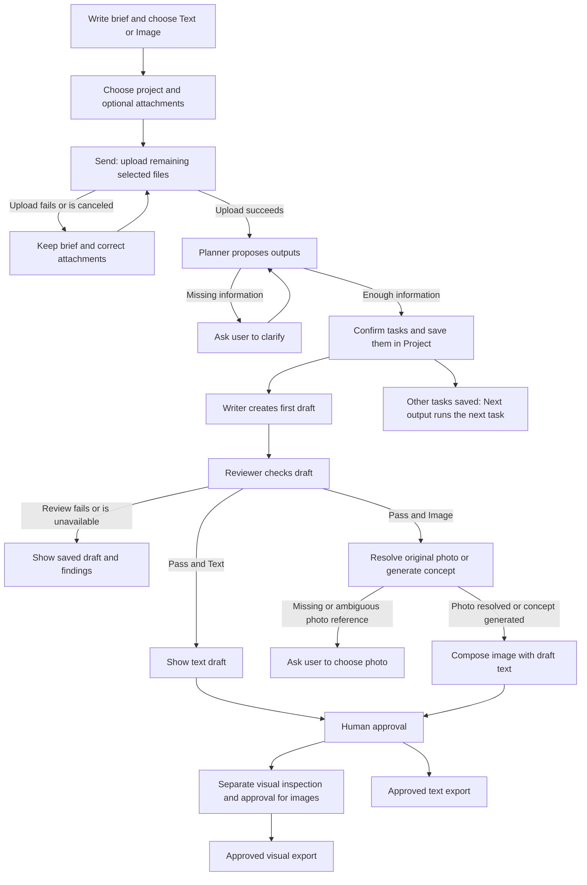

# RekaRasa engineering handoff - 5 November 2026

## Working agreement

Engineering can proceed while the UI/UX and user-flow work continues. Keep screen design separate from persisted task state, source ownership, draft versions, review outcomes, and approval decisions. The current implementation is a Python WSGI application with SQLite and a JavaScript frontend. This document records current behavior and specific changes; it is not a production-readiness certificate.

## Implemented in this engineering pass

- Plan confirmation reads and writes under BEGIN IMMEDIATE. The shared task-creation function verifies the plan is still proposed and belongs to the requested project owner. A competing confirmation receives 409 rather than creating another task set.
- Initial generation calls the Writer without holding a database write lock, then takes a write lock and checks that the task still exists, is not archived, and has no saved version. Another completed request wins; the later result is rejected without inserting a duplicate draft. This prevents duplicate persistence, not duplicate model billing.
- Before storing a generated draft, referenced sources are checked against the active project sources again. A source archived during generation causes a sources_changed conflict rather than being silently used in new work.
- The local brief is cleared after switching to the generation screen, so shell navigation cannot immediately save the submitted form again.
- Restoring a local brief restores Text versus Image mode consistently with its preferences.

No schema migration, credentials change, or user-data rewrite was required.

## Current journey for the user-flow owner

Clarifications: only the first task runs immediately; other tasks are saved and generated on Next output. Planning does not grant human approval. Images with no supplied reference are concepts, not verified photographs of the real product. A generated visual does not verify certificates or legal compliance.

## API and ownership contract for UI/UX

| Operation | Contract |
| --- | --- |
| POST /api/plan | Produces a saved plan; auto_confirm can create tasks when information is sufficient. Catalog plans can still require confirmation through the existing path. |
| POST /api/confirm-plan | Creates tasks once. A confirmed or archived plan returns 409. |
| POST /api/generate | Creates the first version and runs review. Existing drafts require the revision flow. |
| GET /api/projects | Authoritative project/task/version state for resuming after navigation or a lost response. |
| GET /api/images | Returns images, compositions, and deterministic photo-selection metadata. |
| POST /api/use-project-image | Uses an original project asset without claiming a model studied its pixels. |
| POST /api/compose-visual | Binds displayed image copy to a saved image and current draft version. |

Keep separate states for planned work, review in progress, revision needed, review passed, human-approved copy, and human-approved visual. Never show a provider request as successful before its saved result exists.

## Decisions to coordinate

1. UI/UX: decide where loading, error recovery, format selection, revisions, and approval appear. Keep the first output visible without exposing every technical control.
2. User-flow owner: confirm the missing-information branch, photo-selection branch, and where a user resumes after refresh.
3. Engineering: preserve API contracts and ownership checks while those presentation decisions change.

## Remaining engineering work and constraints

- Long inference still runs inside HTTP requests. There is no durable job queue or worker recovery after a server crash. The bundled development server processes requests synchronously; deploy concurrency and workload handling require a deliberate next pass.
- Concurrent initial generation can still call the model twice; this pass only ensures one initial draft is saved. Durable generation leases or an idempotency-key/job contract are needed to avoid duplicate provider cost across requests and restarts.
- A process stopping during review can leave an in-progress state. Durable job recovery needs to own that lifecycle before production.
- Multi-task generation is sequential and user-driven, not a background campaign batch.
- End-to-end SMTP delivery, actual model quality, photo mapping, and approval/export behavior need explicit verification before release. A configured provider is not proof of delivery or output quality.

## Validation of this pass

Python and JavaScript syntax and scoped diff whitespace checks only. No automated tests, provider generation, SMTP messages, or real database mutations were run. The concurrency changes require integration verification before being described as proven under load.

## Optional Cloudflare concepts

An additional explicitly selected image provider is prepared; ComfyUI remains the default and original-photo editing stays local. See [Cloudflare setup](CLOUDFLARE_IMAGE_SETUP.md). The Worker and backend validate request sizes, authentication, permitted canvases and returned image dimensions. Worker rate limiting is approximate per location. No automatic fallback/retry is introduced; Cloudflare receives text context only. Existing image ownership, private storage, audit records, copy composition and approval are retained.

Deployment and live generation are pending operator URL/secret configuration. Python AST parsing, JavaScript syntax checks and whitespace checks completed; no automated tests or live image calls were run for this addition. The account Free-plan confirmation is a manual assertion, not a live billing check.

## Follow-up: reference-conditioned generation and handbook gates

See [Challenge C implementation and validation](CHALLENGE_C_IMPLEMENTATION_2026-11-05.md). Added direct image-to-image with strength control, source-bound preview/provenance, post-inference source/version checks, and non-mock certificate uncertainty by default. This follow-up passed 66 targeted tests and two actual local ComfyUI generations. Earlier verification limits above are historical. No model upgrade or Cloudflare deployment was performed.
