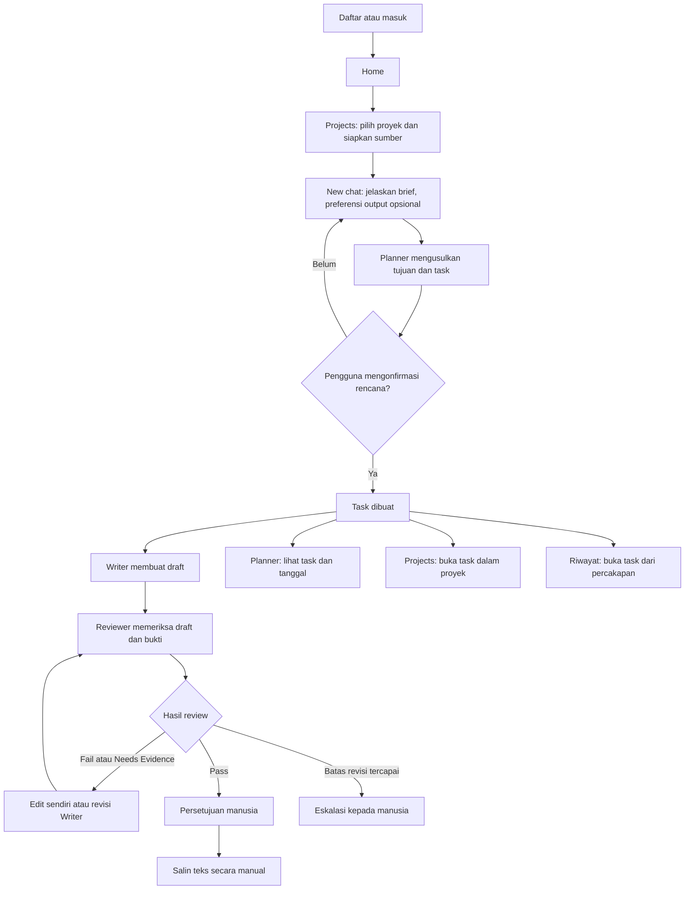

# RekaRasa.ai: Dokumentasi Produk dan Alur Menu

Dokumen ini memisahkan kemampuan yang tersedia sekarang dari gagasan pengembangan. Status di bawah dicocokkan dengan antarmuka, route backend, dan skema database pada versi demo ini. Rencana pengembangan adalah usulan, bukan komitmen jadwal.

## Status fitur

| Area | Status sekarang |
|---|---|
| Akun, proyek, sumber, brief, rencana, task, versi draft, review, dan keputusan manusia | Tersedia; disimpan di SQLite dan dibatasi per akun. |
| Planner list/calendar dan tanggal task | Tersedia; tanggal dimasukkan pengguna. |
| Salin dan unduh teks yang disetujui | Tersedia; clipboard atau file TXT manual. |
| Generate Visual pada workbench | Tersedia; OpenAI Images (default) atau ComfyUI lokal dengan checkpoint yang dikonfigurasi. Prompt memakai konteks task dan sumber proyek. |
| Percakapan terdahulu | Tersedia melalui Riwayat. |
| Impor spreadsheet, folder bertingkat/campaign, ide dan outline AI, SEO, generasi video | Belum tersedia pada UI maupun alur aplikasi saat ini. |
| Jadwal/publikasi eksternal, pengingat, kolaborasi multi-user, PDF, pemulihan kata sandi | Belum tersedia. |

## Alur utama

Task yang dibuka dari Planner, Projects, atau Riwayat menggunakan ID task yang sama. Riwayat menyimpan konteks percakapan; versi, review, keputusan, dan visual disimpan pada entitas task terkait. Ada pula audit event backend, tetapi saat ini tidak ada halaman audit khusus pada navigasi.

## Masuk dan Home

Pengguna dapat membuat akun dengan email dan kata sandi atau masuk ke akun yang sudah ada. Kata sandi minimal 12 karakter. Akun baru memperoleh proyek contoh **Demo · Jahe Rasa**. Tidak tersedia verifikasi email, reset kata sandi, login pihak ketiga, atau kolaborasi multi-user.

Home menampilkan task yang perlu tindakan (revisi, eskalasi, atau menunggu persetujuan), pintasan memulai brief dan membuka proyek, beberapa proyek terbaru, serta pintasan melihat aturan demo. Navigasi utama adalah **Home**, **New chat**, **Planner**, **Projects**, dan **Riwayat**. **Settings** dibuka lewat area akun; di sana pengguna dapat keluar melalui **Sign out**.

## New chat: brief dan rencana

New chat menerima brief bahasa alami (maksimum 10.000 karakter), proyek tujuan, audiens, serta tone/batasan. Preferensi output bersifat opsional. Planner dapat menyusun satu sampai enam task berdasarkan brief dan sumber proyek. Contoh preferensi yang tersedia: poster/static ad, product hero image, social media content, short-form video, marketplace listing, campaign bundle, atau format custom.

Format task baru berupa teks bebas agar deliverable custom tetap dapat direpresentasikan. Task lama dengan format TikTok, Social video script, dan Marketplace description tetap didukung.

Planner memberi alasan singkat untuk setiap deliverable. Fakta produk yang disampaikan Planner hanya ditampilkan sebagai fakta jika teksnya ditemukan di brief pengguna atau sumber proyek; detail yang tidak tersedia ditandai sebagai informasi yang perlu dilengkapi. Preferensi eksplisit harus tercakup dalam rencana. Writer mendapat panduan khusus untuk skrip video, listing marketplace, copy poster/static ad, arahan product hero image, dan campaign bundle.

Task poster/static ad saat ini menghasilkan copy headline, body, dan CTA sebagai teks terpisah dari visual. Editor overlay teks pada gambar belum tersedia; image generation tidak menjamin ejaan teks yang akurat.

Fakta produk tidak diimpor di form brief. Tambahkan lebih dulu di sumber proyek melalui Projects. Deadline dan waktu publikasi juga bukan input brief; keduanya diatur pada task setelah task dibuat.

Alurnya:

1. Pilih proyek dan tulis brief. Audiens, tone, batasan, serta preferensi output dapat diisi jika relevan.
2. Tekan **Plan my content**. Planner menyusun objektif, audiens, fakta yang didukung, batasan, informasi yang belum tersedia, dan satu atau lebih task dengan alasan pemilihannya.
3. Periksa usulan. Pengguna dapat mengubah judul, format, platform/channel, angle, dan goal; menghapus output; atau menambah hingga enam output. Setiap output perlu judul, format, angle, dan goal. Pengguna dapat kembali mengubah brief atau mengonfirmasi rencana.
4. Setelah konfirmasi, task tersimpan. Writer dan Reviewer dijalankan untuk task tersebut; jika panggilan gagal, task dapat dicoba lagi dari workbench.
5. Di workbench, bagian **Content Studio / Image** menyiapkan prompt dari brief, detail task, serta sumber proyek. Edit arahan visual, pilih kanvas square (1:1), portrait (4:5), atau story (9:16), lalu pilih **Generate Visual**. Provider default OpenAI Images; alternatif `IMAGE_PROVIDER=comfyui` mengirim workflow SD 1.5 ke ComfyUI lokal lewat `/prompt`, memantau `/history/{prompt_id}`, lalu mengambil PNG dari `/view`. File dan metadata disimpan dengan project serta task. ComfyUI memerlukan `COMFYUI_CHECKPOINT` dengan nama checkpoint terpasang yang tepat.

Tidak ada impor daftar task/spreadsheet. Planner tidak boleh diperlakukan sebagai sumber fakta produk; klaim perlu didukung brief pengguna atau sumber proyek. Jika pemanggilan model gagal, brief dan task tidak disimpan; percobaan ulang tidak menggandakan riwayat.

## Projects: proyek, sumber, dan pekerjaan

Projects saat ini adalah daftar proyek datar. Pengguna dapat membuat proyek, mengganti namanya, membuka detail, menambahkan sumber, melihat task terkait, dan membuka aturan review demo. Fitur folder bertingkat, campaign, pengarsipan, atau pemindahan output antar proyek tidak tersedia.

Sumber mendukung teks biasa dan Markdown: berkas .txt, .md, .markdown hingga 250 KB, atau teks yang ditempel. Isinya tersimpan di database proyek dan dapat dipakai Planner/Reviewer. PDF tidak didukung. Berhasil menyimpan sumber tidak berarti sumber telah diverifikasi; isi sumber juga diperlakukan sebagai referensi, bukan instruksi.

Projects, Planner, dan workbench merujuk data proyek/task yang tersimpan sama. Data aplikasi disimpan dalam SQLite; penggunaan deployment memerlukan penyimpanan persisten yang sesuai konfigurasi.

## Planner: daftar, kalender, tanggal

Planner menyediakan tampilan **List** dan **Calendar**:

- List mengelompokkan task menurut status dan mengurutkan berdasarkan deadline atau waktu publikasi yang diisi.
- Calendar memiliki navigasi bulan, tombol **Today**, pemilih tanggal, serta filter proyek dan format. Memilih task membuka workbench.
- Kalender saat ini tidak menyediakan filter status/platform/rentang tanggal dan tidak memakai thumbnail.

Setelah rencana dikonfirmasi, setiap output menjadi task independen dengan judul, platform, format, angle, dan goal tersimpan sendiri. Task berbagi brief, rencana, dan proyek sumber yang sama, tetapi memiliki versi, review, dan approval masing-masing. Migrasi database menambahkan detail task ke SQLite tanpa menghapus catatan task yang ada.

Task memiliki tiga informasi tanggal/status yang berbeda:

- **Content plan** berisi tujuan, format, angle, dan goal task dari rencana yang dikonfirmasi.
- **Production deadline** adalah tanggal penyelesaian kerja.
- **Planned publication time** adalah waktu publikasi yang direncanakan.

Deadline dan waktu publikasi diatur terpisah dari tombol **Dates** pada workbench. Tanggal yang kosong tidak dibuat otomatis. Planned publication time hanya catatan kalender: tidak ada pengingat, integrasi scheduling, atau publikasi ke platform.

## Content workbench: draft, review, dan keputusan

Workbench menampilkan judul, platform, format, status task, draft terbaru, riwayat versi, temuan Reviewer, rujukan sumber/aturan yang tersedia, pertukaran agen, kontrol tanggal, bagian Generate Visual, serta tindakan berikutnya. Skrip TikTok ditampilkan dengan penekanan pada penanda hook/scene/CTA; deskripsi marketplace menyorot label judul dan deskripsi jika Writer mengembalikannya.

- Draft dapat diedit menjadi versi baru. Versi lama tetap tersimpan.
- Visual merupakan aset terpisah; generasi gambar tidak menjalankan BuktiDulu/Reviewer atau mengubah versi dan approval teks. Visual belum disetujui atau diterbitkan. Periksa detail produk dan teks yang mungkin muncul di gambar secara manual.
- Draft hasil edit dikirim untuk review; versi yang diedit belum dianggap lolos.
- Task yang perlu revisi dapat dikirim ke Writer. Maksimal tiga percobaan revisi otomatis per task; setelah batas tersebut, kasus dieskalasi.
- Jika review versi terbaru **Pass**, pengguna dapat menyetujui atau meminta perubahan.
- Jika pengguna menolak, task masuk ke status eskalasi untuk keputusan manusia.
- Persetujuan hanya berlaku untuk versi terbaru. Perubahan setelah persetujuan membuat versi baru yang perlu review dan approval lagi.
- Tombol **Copy approved text** dan **Download .txt** aktif hanya setelah persetujuan manusia. Ekspor berupa teks lokal dan tidak menandai konten sebagai terbit.

## Reviewer dan aturan demo

Setiap temuan dapat menunjukkan status **Pass**, **Fail**, atau **Needs Evidence**, bagian klaim, penjelasan, rekomendasi, serta aturan dan sumber bukti bila ada. Pemeriksaan dibatasi pada aturan demo yang terdaftar: dukungan fakta/sumber, klaim penyembuhan/pengobatan/pencegahan penyakit, bukti sertifikasi halal, dan kesesuaian tone. Pemeriksaan format-platform bukan checklist terpisah yang dijamin oleh aturan demo.

Sistem memvalidasi referensi aturan dan sumber; referensi yang tidak sah tidak dihitung sebagai bukti. Klaim penyakit yang dibatasi mempunyai guard deterministik tambahan. Instruksi Reviewer juga meminta pemeriksaan kecocokan platform/format, tetapi ini bukan aturan terdaftar tersendiri atau validasi format deterministik. Needs Evidence berarti bukti belum cukup, bukan bukti verifikasi. Aturan ini contoh kebijakan produk, bukan nasihat hukum, penilaian sertifikasi halal, atau sistem kepatuhan lengkap. Keputusan akhir ada pada manusia.

## Riwayat, audit, dan Settings

**Riwayat** menampilkan percakapan yang tersimpan. Membukanya memperlihatkan brief, rencana, task terkait, dan pilihan melanjutkan brief dengan konteks sebelumnya. Riwayat percakapan berbeda dari versi draft dan audit event.

Versi, hasil review, persetujuan, penggunaan token, dan audit event disimpan oleh backend. Workbench memperlihatkan versi serta pertukaran agen. Endpoint audit tersedia di backend, tetapi navigasi belum menyediakan layar untuk menelusuri audit event lengkap.

**Settings** menampilkan akun, status provider/model, penyimpanan, aturan demo, pemakaian token, dan **Sign out**. Status configured/connected menunjukkan konfigurasi provider tersedia; bukan jaminan bahwa setiap permintaan model berhasil. Panggilan dapat gagal karena kredensial, batas provider, jaringan, atau respons tidak valid. Biaya model tidak dihitung.

## Status task yang digunakan

| Status internal | Label UI | Makna |
|---|---|---|
| planned | Planned | Rencana dikonfirmasi dan task dibuat; draft belum ada. |
| reviewing | In review | Draft sedang dibuat atau task menunggu proses review. |
| needs_revision | Revision needed | Review meminta perubahan; revisi Writer tersedia sampai batas percobaan. |
| escalated | Needs a human | Memerlukan keputusan manusia, termasuk setelah penolakan atau batas revisi. |
| approved_pending_human | Ready for approval | Review versi terbaru lulus; menunggu keputusan manusia. |
| human_approved | Human approved | Versi terbaru disetujui dan dapat disalin manual. |

Tidak ada status Drafting atau Published tersendiri. Aplikasi tidak menerbitkan konten, sehingga status Published tidak digunakan.

## Usulan pengembangan (belum tersedia)

Arahan produk yang dilampirkan mengusulkan pengembangan berikut. Bagian ini bukan klaim bahwa kemampuan tersebut sudah dibuat:

1. **Impor spreadsheet:** preview, validasi, pemetaan kolom, dan satu task per baris valid. Belum ada importer CSV/XLSX.
2. **Perencanaan kreatif lebih luas:** brainstorming ide/outline, platform tambahan, dan polishing sebagai tahapan terpisah. Planner kini dapat memilih hingga enam deliverable dari satu brief; output preferences tidak wajib dan format bebas dapat diedit sebelum konfirmasi.
3. **SEO opsional:** saran keyword hanya jika ada sumber/integrasi yang mendukung; belum tersedia.
4. **Organisasi proyek:** folder, campaign, dan pengelolaan output lebih lanjut; belum tersedia.
5. **Konteks brand lebih kaya:** penggunaan kembali panduan brand dan referensi terstruktur; saat ini sumber proyek berupa teks/Markdown.
6. **Audit UI:** halaman untuk menelusuri audit event yang saat ini hanya tersedia di backend.
7. **Distribusi dan video:** integrasi platform, penjadwalan/publikasi, unggah visual, storyboard, dan generasi video belum tersedia. Generate Visual sudah tersedia sebagai aset gambar; ekspor TXT tersedia untuk konten yang disetujui.

## Pemeriksaan implementasi

Audit terkini menjalankan 30 tes backend, termasuk fake ComfyUI untuk antrean, polling status, unduh PNG, checkpoint wajib, dan timeout. ComfyUI lokal tidak merespons pada `127.0.0.1:8188` saat audit; integrasi live belum terverifikasi. Catatan sebelumnya menyebut smoke test OpenAI Images berakhir HTTP 502 dan live Groq Planner HTTP 403; keduanya tidak diuji ulang dalam sesi ini. Publikasi eksternal tidak tersedia.
